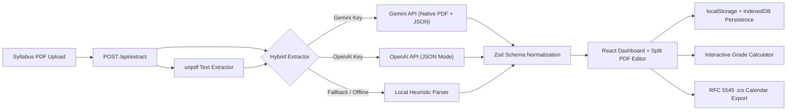

# SyllabusLens

**SyllabusLens** is a full-stack Next.js & TypeScript web application that turns university course outline PDFs into a structured, interactive semester hub.

Upload any course syllabus PDF to extract:
- **Instructor & Staff Info** — Name, email, office location, office hours, and Teaching Assistants
- **Exam Dates & Assessments** — Midterms, finals, times, rooms, weights, countdown badges, and one-click `.ics` calendar export
- **Required & Suggested Textbooks** — Title, authors, edition, ISBN, and required/suggested classification
- **Suggested Exercises** — Chapter/topic practice problem checklist with progress tracking
- **Grading Scheme & Interactive Grade Calculator** — Stacked weight distribution, 100% validation, live weighted grade, and a **"What do I need on remaining assessments?"** target planner

---

## Key Features

- **Hybrid AI + Local Heuristic Engine**:
  - Works out of the box with **zero API keys** via the built-in local heuristic syllabus parser.
  - Optionally plug in a **Google Gemini API key** (supports scanned/image-only PDFs natively!) or **OpenAI API key** via `.env.local` or the in-app **AI Settings** modal for higher accuracy across unusual syllabus layouts.
- **Side-by-Side PDF Verification & Inline Editing**:
  - Uploaded PDFs are persisted privately in browser IndexedDB so you can view the original syllabus alongside every extracted field and fix any detail inline.
- **Multi-Course Dashboard & Cross-Course Exam Timeline**:
  - Track all courses for the semester, search/filter by term, monitor upcoming exam countdowns across every class, and export/import JSON workspace backups.
- **RFC 5545 Calendar Export (`.ics`)**:
  - Export an individual exam, a single course's exams, or all exams across all courses with automatic 7-day and 1-day `VALARM` reminders for Google Calendar, Apple Calendar, and Outlook.

---

## Architecture



---

## Tech Stack

- **Framework**: Next.js 15 (App Router), React 19, TypeScript
- **Styling**: Tailwind CSS, Lucide Icons
- **PDF Processing**: `unpdf` (text extraction), `pdf-lib` (sample syllabus generator)
- **Validation**: `zod`
- **Testing**: Vitest
- **CI**: GitHub Actions (`.github/workflows/ci.yml`)

---

## Getting Started

### 1. Install dependencies

```bash
npm install
```

### 2. (Optional) Configure AI API keys

Copy `.env.example` to `.env.local` if you want server-side AI extraction (skip this step to use the built-in local heuristic parser or enter keys later in the UI):

```bash
cp .env.example .env.local
```

```env
GEMINI_API_KEY=your_gemini_api_key_here
# or
OPENAI_API_KEY=your_openai_api_key_here
```

### 3. Generate the sample syllabus PDF & run the dev server

```bash
npm run generate:sample
npm run dev
```

Open [http://localhost:3000](http://localhost:3000) in your browser and click **Try Sample CS 301 Syllabus** or upload your own course outline PDF!

---

## Scripts

| Command | Description |
| --- | --- |
| `npm run dev` | Start the Next.js development server |
| `npm run build` | Create an optimized production build |
| `npm run start` | Start the production server |
| `npm run typecheck` | Run TypeScript strict type-checking (`tsc --noEmit`) |
| `npm test` | Run unit tests with Vitest |
| `npm run generate:sample` | Regenerate `public/sample-syllabus.pdf` |

---

## Project Structure

```text
syllabus-lens/
├── .github/workflows/ci.yml      # GitHub Actions CI pipeline
├── public/sample-syllabus.pdf    # Sample CS 301 course outline PDF
├── scripts/
│   └── generate-sample-pdf.mjs   # Generates realistic sample syllabus PDF
└── src/
    ├── app/
    │   ├── api/config/route.ts   # Reports whether server AI keys exist
    │   ├── api/extract/route.ts  # PDF upload + hybrid extraction endpoint
    │   ├── globals.css
    │   ├── layout.tsx
    │   └── page.tsx
    ├── components/
    │   ├── CourseDetailView.tsx  # Split PDF viewer & inline editor tabs
    │   ├── GradeCalculator.tsx   # Weight distribution & target grade planner
    │   ├── SettingsModal.tsx     # AI provider & API key configuration
    │   ├── SyllabusDashboard.tsx # Multi-course dashboard & exam timeline
    │   └── UploadModal.tsx       # Drag-and-drop PDF uploader + sample loader
    └── lib/
        ├── ai-extractor.ts       # Gemini + OpenAI + heuristic fallback engine
        ├── grades.ts             # Grade calculator math + unit tests
        ├── heuristic-parser.ts   # Section-aware local syllabus parser + tests
        ├── ics.ts                # RFC 5545 .ics calendar exporter + tests
        ├── pdf.ts                # Server-side PDF text extraction via unpdf
        ├── schema.ts             # Zod schema & normalization helpers
        ├── storage.ts            # localStorage & IndexedDB persistence
        └── types.ts              # Shared TypeScript interfaces
```

---

## License

MIT — see [LICENSE](./LICENSE).
